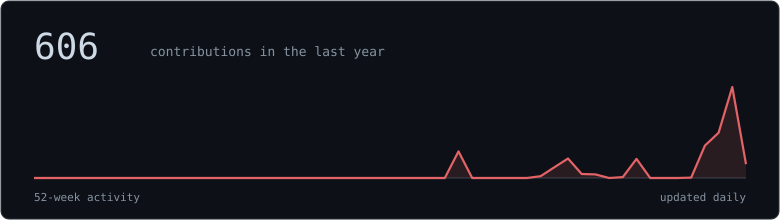
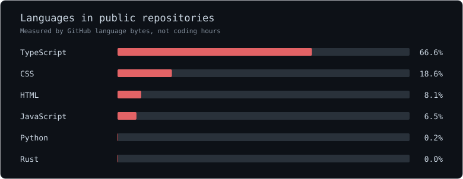

<a href="https://mustaqim.is-a.dev">website</a> &nbsp;·&nbsp; <a href="https://picompiler.pages.dev">pico</a> &nbsp;·&nbsp; <a href="https://www.instagram.com/_mztaq/">instagram</a>

### About

I like building things that help me understand how systems work. Right now that's compilers, digital logic, automation, and the Linux services I run myself.

Learning Rust. Usually writing Python.

### Stack

<samp>Python · TypeScript · Rust (learning) · HTML · CSS</samp>

<samp>Linux · Docker · Git · Cloudflare · FastAPI · n8n</samp>

### Projects

**[Pico](https://github.com/mztaq/pico)** · [try it](https://picompiler.pages.dev)  
Pseudocode compiler, flowcharts, logic gates, and CPU simulations in the browser. Built with my team.

**[MetaStrip](https://github.com/mztaq/meta-strip)**  
Inspect and remove hidden metadata from files.

### GitHub languages

  

