[pico](https://github.com/mztaq/pico) &nbsp;·&nbsp; [meta-strip](https://github.com/mztaq/meta-strip) &nbsp;·&nbsp; [portfolio](https://mustaqim.is-a.dev)

<!-- The SVG contains all animated content. GitHub Actions refreshes public stats daily. -->
